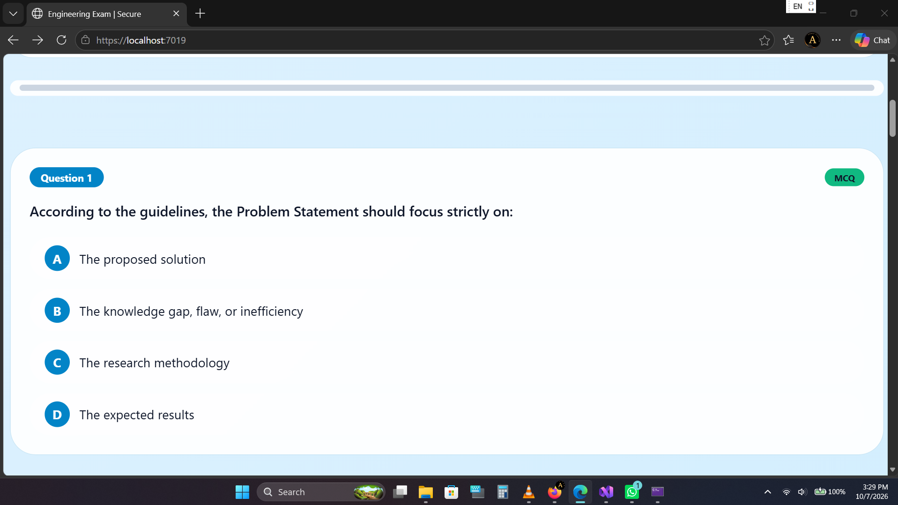
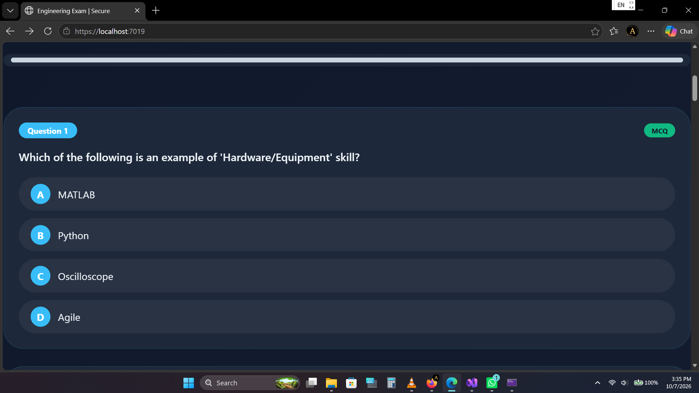

<!-- SPDX-License-Identifier: MIT -->

# Engineering Interactive Exam

A web app where engineering students practice technical writing and engineering English with randomized exams. Built with ASP.NET Core 10, Entity Framework Core and plain JavaScript.

[](https://github.com/Ahmed-M-Elsayad/my-exam-app/actions/workflows/ci.yml)
[](https://dotnet.microsoft.com/)
[](./LICENSE)




## What it does

- Question bank of 219 questions in 23 categories: 111 MCQ, 95 essay, 7 report and 6 true/false.
- Each exam is 15 random questions. You can filter by topic and by question type.
- MCQ options are shuffled in the browser every time an exam starts.
- Grading happens on the server. Correct answers and explanations only come back after you submit.
- Only MCQ and True/False are scored. Essay and report questions are for self-review: after submitting you see a model answer next to your own text, and report questions also come with a marking rubric.
- Light and dark theme (remembered between visits), keyboard navigation, works on phones.

Shuffling does not affect grading: every option keeps its original index, and that index is what gets sent to the server.

## Running it locally

You need the [.NET 10 SDK](https://dotnet.microsoft.com/download/dotnet/10.0).

```bash
git clone https://github.com/Ahmed-M-Elsayad/my-exam-app.git
cd my-exam-app
dotnet run --launch-profile https
```

Then open https://localhost:7019. If the browser complains about the certificate, run `dotnet dev-certs https --trust` once. A plain `dotnet run` uses the first launch profile and serves http://localhost:5152 instead.

The SQLite database is created, migrated and seeded on the first run, so there is no `dotnet ef` step. In Development, Swagger is at `/swagger`.

## API

| Method | Endpoint | Description |
|---|---|---|
| GET | `/api/questions` | Questions, optionally filtered with `?category=&type=`. No answers included. |
| GET | `/api/questions/categories` | List of categories. |
| POST | `/api/exams/evaluate` | Grades the submitted answers and returns the review. |

Example body for the last one:

```json
{
  "answers": [
    { "questionId": 1, "selectedOptionIndex": 0, "freeText": null },
    { "questionId": 2, "selectedOptionIndex": 1, "freeText": null }
  ]
}
```

## Project layout

```text
Domain/           entities and enums
Application/      services, DTOs, interfaces
Infrastructure/   DbContext, seeding, middleware
Controllers/      API endpoints
Migrations/       EF Core migrations
Data/             questions.json (seed data)
wwwroot/          frontend: index.html, style.css, app.js, api.js
Program.cs
```

## Security

Rate limiting, security headers, input validation and server-side grading are in place. Details and known limitations are in [SECURITY.md](./SECURITY.md).

## Roadmap

- User accounts and exam history
- Admin page for editing questions
- Optional exam timer
- Docker image

## License

The code is MIT, see [LICENSE](./LICENSE). The question bank in `Data/questions.json` is copyright 2026 Ahmed Al-Sayad, for educational and non-commercial use.

## Author

Ahmed Al-Sayad, engineering student at the Higher Institute of Engineering and Technology, Kafr El-Sheikh.
[LinkedIn](https://www.linkedin.com/in/ahmed-mohammed-ahmed-saber-abdelhamid-b46249324) | a.elsuad08@gmail.com
